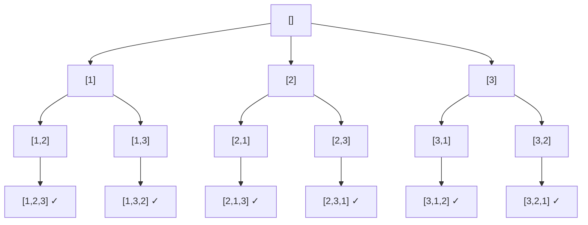

# Backtracking (Поиск с возвратом)

## Описание шаблона

**Backtracking** (поиск с возвратом) — это техника систематического перебора, при
которой решение строится по одному элементу за раз. Как только становится понятно,
что текущий частичный вариант не может привести к допустимому решению, алгоритм
**откатывается** (backtrack) на шаг назад и пробует другой вариант.

По сути это обход в глубину (DFS) по **дереву решений**: каждый узел — частичное
решение, каждое ребро — выбор следующего элемента. Ключевая идея — **«сделал выбор →
рекурсивно продолжил → отменил выбор»**.

## Когда применять

Используйте этот шаблон, когда нужно:

- Сгенерировать **все** комбинации, перестановки или подмножества.
- Найти **все пути** или конфигурации, удовлетворяющие ограничениям (судоку, N ферзей,
  расстановка скобок).
- Решить задачу вида «существует ли последовательность выборов, дающая результат».

Признак-маркер: в условии есть слова «все возможные», «сгенерируйте», «найдите все
комбинации/пути», а размер входа невелик (перебор экспоненциальный).

## Алгоритм/Подход

Общий каркас одинаков почти для всех задач:

```go
func backtrack(current []int, choices []int, result *[][]int) {
    // 1. Базовый случай: текущий вариант — готовое решение
    if isComplete(current) {
        // важно копировать срез, иначе все решения будут ссылаться на один буфер
        solution := make([]int, len(current))
        copy(solution, current)
        *result = append(*result, solution)
        return
    }

    // 2. Перебираем варианты следующего шага
    for _, choice := range choices {
        if !isValid(current, choice) {
            continue // отсечение недопустимых веток (pruning)
        }
        current = append(current, choice) // делаем выбор
        backtrack(current, choices, result)
        current = current[:len(current)-1] // ОТМЕНЯЕМ выбор (backtrack)
    }
}
```

Три обязательных компонента:

1. **Выбор** (`append`) — добавляем элемент в частичное решение.
2. **Ограничения** (`isValid`) — отсекаем заведомо тупиковые ветки как можно раньше.
   Чем раньше отсечение, тем меньше дерево перебора.
3. **Цель** (`isComplete`) — условие, при котором частичное решение становится полным.

### Схема: дерево решений для перестановок [1, 2, 3]



Каждый лист — готовая перестановка. Спускаясь, мы делаем выбор; поднимаясь —
отменяем его и пробуем следующий.

## Пример: генерация всех перестановок

```go
func permute(nums []int) [][]int {
    var result [][]int
    used := make([]bool, len(nums))
    var current []int

    var backtrack func()
    backtrack = func() {
        if len(current) == len(nums) {
            perm := make([]int, len(current))
            copy(perm, current)
            result = append(result, perm)
            return
        }
        for i, n := range nums {
            if used[i] {
                continue
            }
            used[i] = true
            current = append(current, n)
            backtrack()
            current = current[:len(current)-1]
            used[i] = false
        }
    }

    backtrack()
    return result
}
```

## Временная и пространственная сложность

| Задача                | Время        | Память (без учёта вывода) |
|-----------------------|--------------|---------------------------|
| Подмножества          | O(n · 2ⁿ)    | O(n) — глубина рекурсии    |
| Перестановки          | O(n · n!)    | O(n)                       |
| Комбинации C(n, k)    | O(k · C(n,k))| O(k)                       |
| Расстановка скобок    | O(4ⁿ / √n)   | O(n)                       |

Backtracking почти всегда **экспоненциален** — это нормально, ведь решений
экспоненциально много. Главный рычаг ускорения — **раннее отсечение** (pruning):
чем раньше отбрасываем недопустимую ветку, тем меньше реальный перебор.

## Визуализация

> 💡 **Интерактивная демонстрация на примере подмножеств.** Нажимайте «▶»: ядро
> backtracking — **выбор** (берём элемент, синий) → **рекурсия** → **отмена выбора**
> (откат, жёлтый). Снизу копятся готовые результаты. (Виджет работает в собранной книге
> `mdbook serve`/`mdbook build`, а не при просмотре `.md` на GitHub.)

<div class="algo-viz" data-viz="subsets-bt" data-set="1,2,3"></div>

## Типичные ошибки

1. **Забыли скопировать срез перед добавлением в результат.** В Go срез — это
   дескриптор поверх общего массива; если положить в результат сам `current`, все
   записи будут указывать на один буфер и «испортятся» при следующем `append`.
   Всегда `make` + `copy`.
2. **Забыли отменить выбор.** Без `current = current[:len(current)-1]` состояние
   «протекает» в соседние ветки и решения становятся неверными.
3. **Позднее отсечение.** Проверяйте ограничения до рекурсивного вызова, а не в
   базовом случае — иначе дерево перебора раздувается.
4. **Дубликаты.** Для входа с повторами сначала отсортируйте и пропускайте
   `nums[i] == nums[i-1]` на одном уровне, иначе получите одинаковые решения.

## Примеры задач на LeetCode

### Легкие / средние
- [Subsets](https://leetcode.com/problems/subsets/) — все подмножества
- [Permutations](https://leetcode.com/problems/permutations/) — все перестановки
- [Combinations](https://leetcode.com/problems/combinations/) — сочетания C(n, k)
- [Generate Parentheses](https://leetcode.com/problems/generate-parentheses/) — корректные скобки
- [Letter Combinations of a Phone Number](https://leetcode.com/problems/letter-combinations-of-a-phone-number/)

### Сложные
- [N-Queens](https://leetcode.com/problems/n-queens/) — расстановка ферзей
- [Sudoku Solver](https://leetcode.com/problems/sudoku-solver/) — решение судоку
- [Word Search](https://leetcode.com/problems/word-search/) — поиск слова в сетке

## Упражнения

В [Go-тренажёре](https://github.com/fazletdinov/algorithms-book/tree/main/exercises)
есть пакет `backtracking` с заготовками и тестами:

```bash
cd exercises
go test ./backtracking/                 # ваши решения
go test -tags solution ./backtracking/  # эталон
```

Реализуйте `Permutations` (перестановки), `GenerateParentheses` (корректные скобки), `CombinationSum` (комбинации с заданной суммой, повтор разрешён), `SolveNQueensCount` (число расстановок n ферзей) и `LetterCombinations` (буквы на цифрах телефона).

## Связанные шаблоны

- **[Subsets](subsets.md)** — частный случай backtracking (выбор «брать / не брать»).
- **[Tree DFS](tree-dfs.md)** — backtracking это и есть DFS по дереву выборов.
- **Dynamic Programming** — когда подзадачи перекрываются, перебор с возвратом часто
  заменяется мемоизацией/DP для устранения повторных вычислений.
