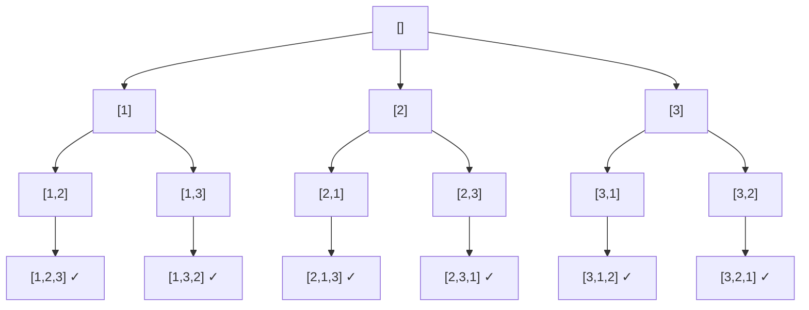

# 🧩 Backtracking (Поиск с возвратом)

<div class="algo-hero">
  <div class="algo-hero__main">
    <div class="algo-hero__name">Backtracking <span class="algo-hero__ru">Поиск с возвратом</span></div>
    <div class="algo-hero__tag">Перебор по дереву решений: выбор → рекурсия → отмена выбора</div>
  </div>
  <div class="algo-hero__metrics">
    <div class="algo-hero__metric"><span>Время</span><b>экспонента</b></div>
    <div class="algo-hero__metric"><span>Память</span><b>O(n)</b></div>
  </div>
</div>

<div class="algo-cards2">
  <div class="algo-card algo-card--yes">
    <div class="algo-card__hdr">Когда применять</div>
    <ul>
      <li>сгенерировать <b>все</b> подмножества / перестановки / комбинации</li>
      <li>найти <b>все пути</b> или конфигурации под ограничения (N ферзей, судоку, скобки)</li>
      <li>«существует ли последовательность выборов, дающая результат»</li>
      <li>вход небольшой (перебор экспоненциальный)</li>
    </ul>
  </div>
  <div class="algo-card algo-card--no">
    <div class="algo-card__hdr">Когда НЕ применять</div>
    <ul>
      <li>подзадачи перекрываются → мемоизация / ДП</li>
      <li>нужен один оптимум, а не все варианты, и есть жадный/ДП-подход</li>
      <li>вход большой — экспонента не уложится во время</li>
      <li>нет естественного «дерева выборов»</li>
    </ul>
  </div>
</div>

<p class="algo-hint">🔍 <b>Как распознать в условии:</b> слова <b>«все возможные», «сгенерируйте все», «найдите все комбинации/пути/расстановки»</b> · небольшой вход · N ферзей, судоку, скобки, перестановки.</p>

<div class="algo-mental">
  <div class="algo-mental__icon">💡</div>
  <div class="algo-mental__body">
    <div class="algo-mental__title">Запомни (3 компонента)</div>
    <ul>
      <li><b>Выбор</b> — добавляем элемент в частичное решение (<code>append</code>);</li>
      <li><b>Рекурсия</b> — идём глубже по дереву выборов;</li>
      <li><b>Отмена</b> — <code>pop</code> возвращает состояние и пробует следующий вариант;</li>
      <li><b>Отсечение (pruning)</b> — отбрасывай тупиковые ветки как можно раньше.</li>
    </ul>
    <p>Это DFS по дереву решений. В Go обязательно <b>копируй срез</b> (<code>make</code>+<code>copy</code>) перед добавлением в результат — иначе все решения сошлются на один буфер.</p>
  </div>
</div>

## 🎬 Визуализация

> 💡 **Интерактивная демонстрация на примере подмножеств.** Ядро backtracking: **выбор** (берём
> элемент, синий) → **рекурсия** → **отмена** (откат, жёлтый). В строке «Найдено» копятся готовые
> подмножества. Справа — код с подсветкой строки и переменные, внизу — кликабельные шаги. Можно
> подставить своё множество и нажать «⟲ Запустить». (Виджет работает в собранной книге
> `mdbook serve`/`mdbook build`, а не при просмотре `.md` на GitHub.)

<div class="algo-viz" data-viz="subsets-bt" data-set="1,2,3"></div>

## ⚡ Шаблон для собеседования

```go
func backtrack(current []int, choices []int, result *[][]int) {
    if isComplete(current) { // 1. готовое решение
        solution := make([]int, len(current))
        copy(solution, current) // копируем срез!
        *result = append(*result, solution)
        return
    }
    for _, choice := range choices {
        if !isValid(current, choice) {
            continue // 2. отсечение тупиков (pruning)
        }
        current = append(current, choice)      // выбор
        backtrack(current, choices, result)     // рекурсия
        current = current[:len(current)-1]      // отмена (backtrack)
    }
}
```

1. базовый случай: частичное решение готово → копируем в результат;
2. перебираем варианты, отсекая недопустимые;
3. делаем выбор → рекурсия → **отменяем** выбор.

## 📖 Разбор

<details class="algo-details">
<summary>Теория, дерево решений, пример перестановок и сложность</summary>

**Backtracking** — техника систематического перебора, при которой решение строится по
одному элементу за раз. Как только понятно, что текущий частичный вариант не приведёт к
допустимому решению, алгоритм **откатывается** на шаг назад. По сути это обход в глубину
(DFS) по **дереву решений**: узел — частичное решение, ребро — выбор следующего элемента.

Три обязательных компонента: **выбор** (`append`), **ограничения** (`isValid`,
раннее отсечение) и **цель** (`isComplete`).

#### Дерево решений для перестановок [1, 2, 3]



#### Пример: все перестановки

```go
func permute(nums []int) [][]int {
    var result [][]int
    used := make([]bool, len(nums))
    var current []int

    var backtrack func()
    backtrack = func() {
        if len(current) == len(nums) {
            perm := make([]int, len(current))
            copy(perm, current)
            result = append(result, perm)
            return
        }
        for i, n := range nums {
            if used[i] {
                continue
            }
            used[i] = true
            current = append(current, n)
            backtrack()
            current = current[:len(current)-1]
            used[i] = false
        }
    }

    backtrack()
    return result
}
```

#### Сложность

| Задача                | Время        | Память (без вывода) |
|-----------------------|--------------|---------------------|
| Подмножества          | O(n · 2ⁿ)    | O(n)                |
| Перестановки          | O(n · n!)    | O(n)                |
| Комбинации C(n, k)    | O(k · C(n,k))| O(k)                |
| Расстановка скобок    | O(4ⁿ / √n)   | O(n)                |

Backtracking почти всегда **экспоненциален** — решений экспоненциально много. Главный
рычаг ускорения — **раннее отсечение** (pruning).

</details>

## ⚠️ Типичные ошибки

1. **Забыли скопировать срез перед добавлением в результат.** В Go срез — дескриптор
   поверх общего массива; положив сам `current`, все записи будут указывать на один буфер.
   Всегда `make` + `copy`.
2. **Забыли отменить выбор.** Без `current = current[:len(current)-1]` состояние
   «протекает» в соседние ветки.
3. **Позднее отсечение.** Проверяйте ограничения до рекурсивного вызова, а не в базовом
   случае — иначе дерево перебора раздувается.
4. **Дубликаты.** Для входа с повторами сначала отсортируйте и пропускайте
   `nums[i] == nums[i-1]` на одном уровне.

## 🧩 Задачи

**LeetCode:**

- [Subsets](https://leetcode.com/problems/subsets/) — все подмножества
- [Permutations](https://leetcode.com/problems/permutations/) — все перестановки
- [Combinations](https://leetcode.com/problems/combinations/) — сочетания C(n, k)
- [Generate Parentheses](https://leetcode.com/problems/generate-parentheses/) — корректные скобки
- [Letter Combinations of a Phone Number](https://leetcode.com/problems/letter-combinations-of-a-phone-number/)
- [N-Queens](https://leetcode.com/problems/n-queens/) — расстановка ферзей (сложная)
- [Sudoku Solver](https://leetcode.com/problems/sudoku-solver/) — решение судоку (сложная)
- [Word Search](https://leetcode.com/problems/word-search/) — поиск слова в сетке

**Тренажёр** — пакет `backtracking`:

```bash
cd exercises
go test ./backtracking/                 # ваши решения
go test -tags solution ./backtracking/  # эталон
```

Реализуйте `Permutations` (перестановки), `GenerateParentheses` (корректные скобки), `CombinationSum` (комбинации с заданной суммой, повтор разрешён), `SolveNQueensCount` (число расстановок n ферзей) и `LetterCombinations` (буквы на цифрах телефона).

## 🔗 Связанные шаблоны

- **[Subsets](subsets.md)** — частный случай backtracking (выбор «брать / не брать»).
- **[Tree DFS](tree-dfs.md)** — backtracking это и есть DFS по дереву выборов.
- **[Dynamic Programming](dynamic-programming.md)** — когда подзадачи перекрываются,
  перебор с возвратом заменяется мемоизацией/ДП.
