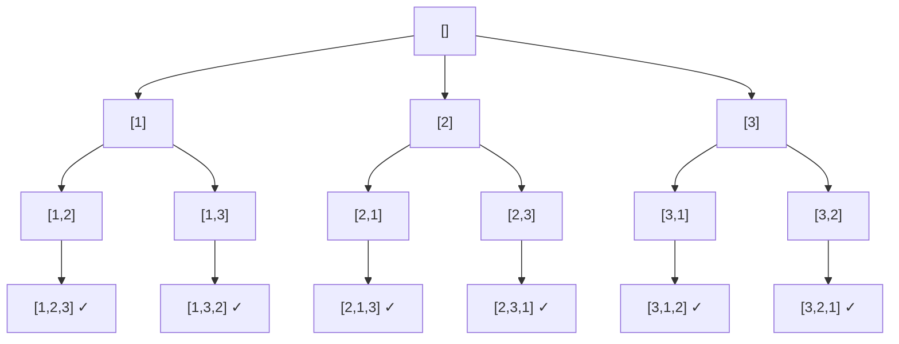

# 🧩 Backtracking (Поиск с возвратом)

<div class="algo-hero">
  <div class="algo-hero__main">
    <div class="algo-hero__name">Backtracking <span class="algo-hero__ru">Поиск с возвратом</span></div>
    <div class="algo-hero__tag">Перебор по дереву решений: выбор → рекурсия → отмена выбора</div>
  </div>
  <div class="algo-hero__metrics">
    <div class="algo-hero__metric"><span>Время</span><b>экспонента</b></div>
    <div class="algo-hero__metric"><span>Память</span><b>O(n)</b></div>
  </div>
</div>

<div class="algo-cards2">
  <div class="algo-card algo-card--yes">
    <div class="algo-card__hdr">Когда применять</div>
    <ul>
      <li>сгенерировать <b>все</b> подмножества / перестановки / комбинации</li>
      <li>найти <b>все пути</b> или конфигурации под ограничения (N ферзей, судоку, скобки)</li>
      <li>«существует ли последовательность выборов, дающая результат»</li>
      <li>вход небольшой (перебор экспоненциальный)</li>
    </ul>
  </div>
  <div class="algo-card algo-card--no">
    <div class="algo-card__hdr">Когда НЕ применять</div>
    <ul>
      <li>подзадачи перекрываются → мемоизация / ДП</li>
      <li>нужен один оптимум, а не все варианты, и есть жадный/ДП-подход</li>
      <li>вход большой — экспонента не уложится во время</li>
      <li>нет естественного «дерева выборов»</li>
    </ul>
  </div>
</div>

<p class="algo-hint">🔍 <b>Как распознать в условии:</b> слова <b>«все возможные», «сгенерируйте все», «найдите все комбинации/пути/расстановки»</b> · небольшой вход · N ферзей, судоку, скобки, перестановки.</p>

<div class="algo-mental">
  <div class="algo-mental__icon">💡</div>
  <div class="algo-mental__body">
    <div class="algo-mental__title">Запомни (3 компонента)</div>
    <ul>
      <li><b>Выбор</b> — добавляем элемент в частичное решение (<code>append</code>);</li>
      <li><b>Рекурсия</b> — идём глубже по дереву выборов;</li>
      <li><b>Отмена</b> — <code>pop</code> возвращает состояние и пробует следующий вариант;</li>
      <li><b>Отсечение (pruning)</b> — отбрасывай тупиковые ветки как можно раньше.</li>
    </ul>
    <p>Это DFS по дереву решений. В Go обязательно <b>копируй срез</b> (<code>make</code>+<code>copy</code>) перед добавлением в результат — иначе все решения сошлются на один буфер.</p>
  </div>
</div>

## 🎬 Визуализация

> 💡 **Интерактивная демонстрация на примере подмножеств.** Ядро backtracking: **выбор** (берём
> элемент, синий) → **рекурсия** → **отмена** (откат, жёлтый). В строке «Найдено» копятся готовые
> подмножества. Справа — код с подсветкой строки и переменные, внизу — кликабельные шаги. Можно
> подставить своё множество и нажать «⟲ Запустить». (Виджет работает в собранной книге
> `mdbook serve`/`mdbook build`, а не при просмотре `.md` на GitHub.)

<div class="algo-viz" data-viz="subsets-bt" data-set="1,2,3"></div>

## ⚡ Шаблон для собеседования

```go
func backtrack(current []int, choices []int, result *[][]int) {
    if isComplete(current) { // 1. готовое решение
        solution := make([]int, len(current))
        copy(solution, current) // копируем срез!
        *result = append(*result, solution)
        return
    }
    for _, choice := range choices {
        if !isValid(current, choice) {
            continue // 2. отсечение тупиков (pruning)
        }
        current = append(current, choice)      // выбор
        backtrack(current, choices, result)     // рекурсия
        current = current[:len(current)-1]      // отмена (backtrack)
    }
}
```

1. базовый случай: частичное решение готово → копируем в результат;
2. перебираем варианты, отсекая недопустимые;
3. делаем выбор → рекурсия → **отменяем** выбор.

## 📖 Разбор

<details class="algo-details">
<summary>Теория, дерево решений, пример перестановок и сложность</summary>

**Backtracking** — техника систематического перебора, при которой решение строится по
одному элементу за раз. Как только понятно, что текущий частичный вариант не приведёт к
допустимому решению, алгоритм **откатывается** на шаг назад. По сути это обход в глубину
(DFS) по **дереву решений**: узел — частичное решение, ребро — выбор следующего элемента.

Три обязательных компонента: **выбор** (`append`), **ограничения** (`isValid`,
раннее отсечение) и **цель** (`isComplete`).

#### Дерево решений для перестановок [1, 2, 3]



#### Пример: все перестановки

```go
func permute(nums []int) [][]int {
    var result [][]int
    used := make([]bool, len(nums))
    var current []int

    var backtrack func()
    backtrack = func() {
        if len(current) == len(nums) {
            perm := make([]int, len(current))
            copy(perm, current)
            result = append(result, perm)
            return
        }
        for i, n := range nums {
            if used[i] {
                continue
            }
            used[i] = true
            current = append(current, n)
            backtrack()
            current = current[:len(current)-1]
            used[i] = false
        }
    }

    backtrack()
    return result
}
```

#### Сложность

| Задача                | Время        | Память (без вывода) |
|-----------------------|--------------|---------------------|
| Подмножества          | O(n · 2ⁿ)    | O(n)                |
| Перестановки          | O(n · n!)    | O(n)                |
| Комбинации C(n, k)    | O(k · C(n,k))| O(k)                |
| Расстановка скобок    | O(4ⁿ / √n)   | O(n)                |

Backtracking почти всегда **экспоненциален** — решений экспоненциально много. Главный
рычаг ускорения — **раннее отсечение** (pruning).

</details>

## 🧠 Почему это корректно

Три вопроса: почему перебор **ничего не пропускает**, почему откат **обязателен**, и
почему результат нужно **копировать**.

### Почему перебор полон и без дублей

Каждый полный кандидат — это **ровно один путь** от корня до листа в дереве решений.
Цикл на каждом уровне перебирает **все** доступные на этом шаге выборы, поэтому:

- **полнота:** любой допустимый кандидат где-то заканчивается листом, а раз мы
  спускаемся по всем рёбрам — этот лист будет достигнут;
- **без повторов:** дисциплина выбора (флаги `used[]` для перестановок, индекс `start`
  для подмножеств/комбинаций) гарантирует, что один и тот же кандидат не построится
  двумя путями.

### Почему откат обязателен

`current` — **общее изменяемое состояние** всех веток. После возврата из `backtrack()`
мы должны вернуть `current` и `used[i]` в прежний вид:

```go
current = append(current, n) // выбрали
backtrack()                  // ушли вглубь
current = current[:len(current)-1] // ← откат: иначе соседняя ветка
used[i] = false                    //   стартует с испорченного префикса
```

Забыли `current = current[:len-1]` или `used[i] = false` — и следующий сосед по циклу
строит кандидата поверх чужого «хвоста». Откат восстанавливает инвариант: *на входе в
каждую итерацию цикла `current` — это префикс ровно до текущего узла*.

### Почему результат копируют, а не добавляют срез

`current` — срез, который **продолжает меняться** после записи. Если положить его в
ответ напрямую (`result = append(result, current)`), все записи окажутся **псевдонимами
одного массива** и в конце станут одинаковыми (последнее состояние). Поэтому снимаем
снимок:

```go
perm := make([]int, len(current))
copy(perm, current)          // независимая копия
result = append(result, perm)
```

### Корректность отсечения (pruning)

Отсечь ветку можно **только** если частичный кандидат **доказуемо** не продолжается ни
в одно допустимое решение (нарушено ограничение). Если срезать ветку, в которой решение
*могло* быть, перебор перестанет быть полным и потеряет ответы. Отсечение ускоряет, но
проверка-условие должна быть **корректной**, иначе это уже не та задача.

## ⚙️ Цена на практике

### Экспонента неизбежна — но дерево можно обрезать

Backtracking почти всегда экспоненциален, потому что **самих решений экспоненциально
много** (2ⁿ подмножеств, n! перестановок) — обойти это нельзя, выходные данные столько и
весят. Стоимость = **(число узлов дерева) × (работа в узле)**. Единственный реальный
рычаг — **отсечение**: чем раньше отбраковываешь тупиковую ветку, тем меньше дерево.

### Проверяй ограничение ДО рекурсии, а не в листе

Дешёвое ускорение: проверяй валидность **перед** спуском, а не только в конце. В
N ферзей проверка диагоналей до рекурсии срезает огромные поддеревья; «сгенерировать
всё, потом отфильтровать» — антипаттерн, который превращает выполнимую задачу в
зависание.

### Снимок стоит `O(длина решения)`

Каждый `copy` готового кандидата — это `O(n)`, и таких копий экспоненциально много:
итоговая работа включает размер вывода. Память самой рекурсии скромная — `O(глубины)`
на стек плюс `O(n)` на `current`; доминирует **выходной** массив, а не служебные данные.

## ⚠️ Типичные ошибки

1. **Забыли скопировать срез перед добавлением в результат.** В Go срез — дескриптор
   поверх общего массива; положив сам `current`, все записи будут указывать на один буфер.
   Всегда `make` + `copy`.
2. **Забыли отменить выбор.** Без `current = current[:len(current)-1]` состояние
   «протекает» в соседние ветки.
3. **Позднее отсечение.** Проверяйте ограничения до рекурсивного вызова, а не в базовом
   случае — иначе дерево перебора раздувается.
4. **Дубликаты.** Для входа с повторами сначала отсортируйте и пропускайте
   `nums[i] == nums[i-1]` на одном уровне.

## 📝 Разбор задачи

Пройдём путь от наивного перебора к отсечённому backtracking — так, как стоит
рассуждать на собеседовании: сначала рабочий, но расточительный перебор, затем
понимание, *откуда* берётся лишняя работа, и только потом обрезанное дерево.

> **Задача (Combination Sum).** Дан массив различных **положительных** чисел
> `candidates` и `target`. Вернуть **все** комбинации, дающие в сумме `target`;
> один и тот же элемент можно брать **сколько угодно раз**. Две комбинации
> различны, если различаются мультимножеством чисел (порядок не важен).
> Пример: `candidates = [2,3,6,7]`, `target = 7` → `[[2,2,3], [7]]`.

**Шаг 1. Наивно: перебрать все последовательности и отфильтровать — экспонента с дублями.**

```go
func combinationSumNaive(candidates []int, target int) [][]int {
    var result [][]int
    var current []int
    var rec func(sum int)
    rec = func(sum int) {
        if sum == target {
            combo := make([]int, len(current))
            copy(combo, current)
            result = append(result, combo)
            return
        }
        if sum > target { // перебрали — тупик
            return
        }
        for _, c := range candidates { // КАЖДЫЙ раз с начала массива
            current = append(current, c)
            rec(sum + c)
            current = current[:len(current)-1]
        }
    }
    rec(0)
    return result
}
```

Это **работает**, но цикл всегда стартует с начала массива, поэтому одна и та же
комбинация строится в разном порядке: `[2,2,3]`, `[2,3,2]`, `[3,2,2]` — три пути к
одному ответу. Мы и раздуваем дерево перестановками, и получаем дубли, которые
придётся вычищать.

**Шаг 2. Ключевое наблюдение.** Чтобы не плодить перестановки одной комбинации,
зафиксируем порядок: на каждом уровне разрешаем брать только элемент с индексом
`≥ start`. Тогда числа в комбинации идут по неубыванию индекса, и каждое
мультимножество строится **ровно одним** путём — ровно та дисциплина «индекс
`start`», что гарантирует
[полноту без повторов](#почему-перебор-полон-и-без-дублей). Повтор элемента
разрешён, поэтому в рекурсию уходит `i`, а **не** `i+1`.

Второй рычаг — отсечение: если `candidates` **отсортирован** и текущий кандидат уже
больше остатка, то все следующие (они ещё больше) тоже не подойдут — ветку можно
оборвать целиком (`break`). Это [корректное отсечение](#корректность-отсечения-pruning):
мы режем только ветки, доказуемо не дающие решения.

**Шаг 3. Оптимум: backtracking с отсечением — без дублей, обрезанное дерево.**

```go
func combinationSum(candidates []int, target int) [][]int {
    sort.Ints(candidates) // для обрыва ветки и порядка по неубыванию
    var result [][]int
    var current []int
    var backtrack func(start, remain int)
    backtrack = func(start, remain int) {
        if remain == 0 { // набрали ровно target
            combo := make([]int, len(current))
            copy(combo, current) // снимок: current ещё будет меняться
            result = append(result, combo)
            return
        }
        for i := start; i < len(candidates); i++ {
            if candidates[i] > remain {
                break // отсортировано ⇒ дальше только больше — обрываем ветку
            }
            current = append(current, candidates[i]) // выбор
            backtrack(i, remain-candidates[i])        // i, не i+1 — повтор разрешён
            current = current[:len(current)-1]        // отмена
        }
    }
    backtrack(0, target)
    return result
}
```

Вместо «сумма» удобнее нести **остаток** `remain`: база — `remain == 0`, отсечение —
`candidates[i] > remain`.

Прогоните перебор с остатком на `candidates = [2,3,6,7]`, `target = 7`: берём кандидата
(можно повторно), уменьшаем `remain`, а ветку с `candidates[i] > remain` обрываем:

<div class="algo-viz" data-viz="combination-sum" data-array="2,3,6,7" data-target="7"></div>

**Шаг 4. Трассировка** на отсортированном `candidates = [2,3,6,7]`, `target = 7`.
Дерево вызовов `backtrack(start, remain)` (слева — `current`, справа — что
происходит):

```text
backtrack(0, 7)                       current=[]
├─ i=0 взяли 2 → backtrack(0, 5)      current=[2]
│  ├─ i=0 взяли 2 → backtrack(0, 3)   current=[2,2]
│  │  ├─ i=0 взяли 2 → backtrack(0,1) current=[2,2,2]
│  │  │  └─ i=0: 2 > 1 → break        (тупик, откат)
│  │  └─ i=1 взяли 3 → backtrack(1,0) current=[2,2,3] ✓ записали [2,2,3]
│  ├─ i=1 взяли 3 → backtrack(1, 2)   current=[2,3]
│  │  └─ i=1: 3 > 2 → break            (3,6,7 все > 2, откат)
│  └─ i=2: 6 > 5 → break               (обрыв ветки [2,…])
├─ i=1 взяли 3 → backtrack(1, 4)      current=[3]
│  ├─ i=1 взяли 3 → backtrack(1, 1)   current=[3,3]
│  │  └─ i=1: 3 > 1 → break            (откат)
│  └─ i=2: 6 > 4 → break
├─ i=2 взяли 6 → backtrack(2, 1)      current=[6]
│  └─ i=2: 6 > 1 → break               (откат)
└─ i=3 взяли 7 → backtrack(3, 0)      current=[7] ✓ записали [7]
```

Результат — `[[2,2,3], [7]]`. Видно, как `break` срезает целые поддеревья
(`6 > 5`, `6 > 4`), а старт с индекса `i` не даёт построить `[3,2,…]` — дубль `[2,3]`
уже учтён в ветке слева. Тот же набор даёт и наивный перебор — но после удаления
перестановок-дублей; отсечённая версия не порождает их вовсе.

## 🧩 Задачи

**LeetCode:**

- [Subsets](https://leetcode.com/problems/subsets/) — все подмножества
- [Permutations](https://leetcode.com/problems/permutations/) — все перестановки
- [Combinations](https://leetcode.com/problems/combinations/) — сочетания C(n, k)
- [Generate Parentheses](https://leetcode.com/problems/generate-parentheses/) — корректные скобки
- [Letter Combinations of a Phone Number](https://leetcode.com/problems/letter-combinations-of-a-phone-number/)
- [N-Queens](https://leetcode.com/problems/n-queens/) — расстановка ферзей (сложная)
- [Sudoku Solver](https://leetcode.com/problems/sudoku-solver/) — решение судоку (сложная)
- [Word Search](https://leetcode.com/problems/word-search/) — поиск слова в сетке

**Тренажёр** — пакет `backtracking`:

```bash
cd exercises
go test ./backtracking/                 # ваши решения
go test -tags solution ./backtracking/  # эталон
```

Реализуйте `Permutations` (перестановки), `GenerateParentheses` (корректные скобки), `CombinationSum` (комбинации с заданной суммой, повтор разрешён), `SolveNQueensCount` (число расстановок n ферзей) и `LetterCombinations` (буквы на цифрах телефона).

## 🧵 Конкурентный перебор (Go)

Дерево перебора с возвратом ветвится: каждый выбор на верхнем уровне открывает **независимое
поддерево**. Это та же ситуация, что в [сортировке слиянием](k-way-merge.md#-конкурентная-сортировка-слиянием-go) —
независимые ветви параллелятся почти бесплатно. Возьмём счёт расстановок **N ферзей**: выбор
столбца для ферзя в первой строке задаёт `n` непересекающихся поддеревьев.

```go
for c := range n {
    go func(c int) {
        // СВОЯ доска: занятость столбцов и диагоналей у каждой горутины своя
        cols, d1, d2 := make([]bool, n), make([]bool, 2*n), make([]bool, 2*n)
        cols[c], d1[c], d2[n-c] = true, true, true
        results[c] = countFrom(1, n, cols, d1, d2) // досчитываем поддерево
    }(c)
}
// wg.Wait(), затем сумма results
```

**Гонки нет by design:** каждая горутина заводит собственные срезы занятости и пишет в свою
ячейку `results`. Никакой общей изменяемой доски — а значит, и замков. На `n=12` конкурентная
версия в бенчмарке тренажёра обгоняет последовательную примерно **в 6–7 раз**.

> 💡 Ключ — не «расставить горутины по рекурсии», а **порезать задачу по верхним веткам** и дать
> каждой полностью свой стейт. Тогда параллелизм даровой. Если же ветви делят изменяемое
> состояние (общий best, счётчик) — придётся синхронизировать, и выигрыш растает.

**Тренажёр** — пакет `parallelnqueens`:

```bash
cd exercises
go test -tags solution ./parallelnqueens/          # эталон
go test -tags solution -race ./parallelnqueens/    # гонок нет by design
go test -tags solution -bench=. ./parallelnqueens/ # Conc обгоняет Seq
```

## 🔗 Связанные шаблоны

- **[Subsets](subsets.md)** — частный случай backtracking (выбор «брать / не брать»).
- **[Tree DFS](tree-dfs.md)** — backtracking это и есть DFS по дереву выборов.
- **[Dynamic Programming](dynamic-programming.md)** — когда подзадачи перекрываются,
  перебор с возвратом заменяется мемоизацией/ДП.
