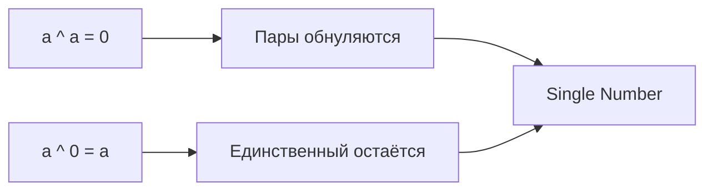
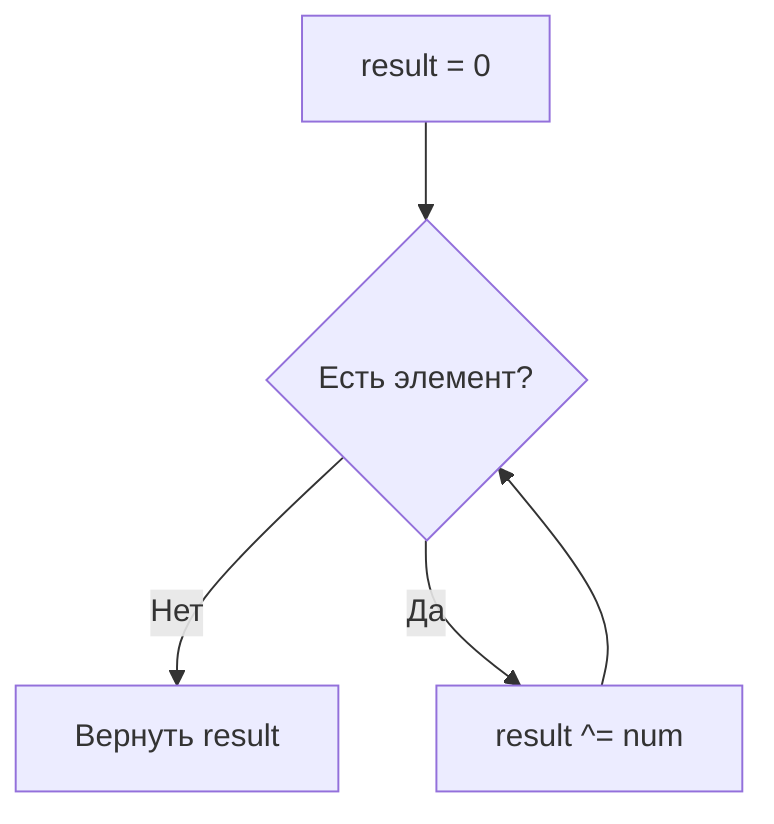

# Bit Manipulation (Битовые операции)

## Описание шаблона

Шаблон **Bit Manipulation** использует побитовые операции (AND, OR, XOR, сдвиги) для решения задач с минимальным использованием памяти. Многие задачи на собеседованиях требуют знания свойств битовых операций, особенно XOR, для поиска единственного элемента или работы с флагами.

### Исторический контекст

Битовые операции — фундамент машинной арифметики и системного программирования. В контексте алгоритмов они позволяют достичь O(1) дополнительной памяти и часто упрощают логику для задач с множествами, флагами и целыми числами.

### Основная идея

Ключевое наблюдение: XOR обладает свойством «самообнуления» — `a ^ a = 0` и `a ^ 0 = a`. Это позволяет находить единственный элемент среди пар, обменивать значения без временной переменной и работать с масками битов.

## Когда применять

Используйте этот шаблон, когда:
- Нужно найти единственный элемент среди пар (каждый элемент встречается дважды, кроме одного)
- Требуется проверить или манипулировать отдельными битами числа
- Задача связана с множествами флагов (включено/выключено)
- Нужна оптимизация памяти до O(1)
- Задача упоминает «числа», «биты», «чётность», «степень двойки»

## Алгоритм/Подход

### Двоичное представление

Целое число в памяти хранится в двоичном виде — последовательностью битов (0 или 1). Позиция бита нумеруется справа налево (младший бит — позиция 0).

**Пример:** число 5 в двоичной системе:
```
5 = 4 + 1 = 2² + 2⁰
Двоично: 0101 (или 101)
Позиции: 3 2 1 0
Биты:    0 1 0 1  →  бит на позиции 0 и 2 установлены
```

Число 8 = 2³: `1000` — один установленный бит (степень двойки). Побитовые операции применяются к соответствующим битам двух чисел.

### Базовые операторы

| Оператор | Обозначение | Описание |
|----------|-------------|----------|
| AND | `&` | 1 только если оба бита 1 |
| OR | `\|` | 1 если хотя бы один бит 1 |
| XOR | `^` | 1 если биты разные |
| NOT | `^x` (унарный в Go) | Побитовое дополнение всех битов (для `int`, `uint` и др.; у знаковых типов — по правилам дополнения до двух) |
| Сдвиг влево | `<<` | Умножение на 2^n |
| Сдвиг вправо | `>>` | Целочисленное деление на 2^n |

### Свойства XOR

- `a ^ a = 0` — одинаковые значения обнуляются
- `a ^ 0 = a` — нейтральный элемент
- `a ^ b ^ a = b` — коммутативность и ассоциативность
- Обмен значениями в Go: идиоматично `a, b = b, a`. Трюк XOR — три последовательных шага (одной строкой с параллельным присваиванием **нельзя** — получится неверный результат): `a ^= b; b ^= a; a ^= b`

### Схема свойств XOR:



### Шаблон: поиск единственного числа (XOR)

```go
// Single Number: единственный элемент встречается 1 раз, остальные — по 2 раза
func singleNumber(nums []int) int {
    result := 0
    for _, num := range nums {
        result ^= num  // Пары обнуляются, остаётся единственный
    }
    return result
}
```

### Схема Single Number:



### Шаблон: проверка степени двойки

```go
// Число является степенью двойки ⟺ имеет ровно один установленный бит
// n & (n-1) обнуляет младший единичный бит
func isPowerOfTwo(n int) bool {
    if n <= 0 {
        return false
    }
    return n&(n-1) == 0
}
```

### Шаблон: подсчёт единичных битов (Brian Kernighan)

```go
func hammingWeight(n uint32) int {
    count := 0
    for n != 0 {
        n &= n - 1  // Удаляем младший установленный бит
        count++
    }
    return count
}
```

### Манипуляции с отдельными битами:

| Операция | Код (Go) | Описание |
|----------|----------|----------|
| Проверить i-й бит | `(n >> i) & 1` | 1 если бит установлен |
| Установить i-й бит | `n \| (1 << i)` | Включить бит |
| Сбросить i-й бит | `n &^ (1 << i)` | Выключить бит (AND NOT) |
| Переключить i-й бит | `n ^ (1 << i)` | XOR с маской |
| Изолировать младший 1 | `n & (-n)` | Получить младший установленный бит |
| Сбросить младший 1 | `n & (n-1)` | Удалить младший бит (Brian Kernighan) |

## Визуализация

### XOR для Single Number [4, 1, 2, 1, 2]:

```
nums: [4, 1, 2, 1, 2]
result = 0

result ^= 4  →  0 ^ 4 = 4     (binary: 0100)
result ^= 1  →  4 ^ 1 = 5     (0100 ^ 0001 = 0101)
result ^= 2  →  5 ^ 2 = 7     (0101 ^ 0010 = 0111)
result ^= 1  →  7 ^ 1 = 6     (0111 ^ 0001 = 0110)
result ^= 2  →  6 ^ 2 = 4     (0110 ^ 0010 = 0100)

Пары (1,1) и (2,2) обнулились. Осталось 4.
```

### n & (n-1) для степени двойки:

```
n = 8:  1000
n-1=7:  0111
8 & 7 = 0000  →  степень двойки ✓

n = 6:  0110
n-1=5:  0101
6 & 5 = 0100  →  не степень двойки
```

### Trace: Hamming Weight (Brian Kernighan) для n=11 (1011):

```
n = 11 (binary: 1011)
count = 0

Итерация 1:
  n & (n-1) = 1011 & 1010 = 1010
  n = 1010, count = 1

Итерация 2:
  n & (n-1) = 1010 & 1001 = 1000
  n = 1000, count = 2

Итерация 3:
  n & (n-1) = 1000 & 0111 = 0000
  n = 0, count = 3

Результат: 3 единичных бита
```

Каждая итерация удаляет ровно один младший установленный бит, поэтому число итераций = число единичных битов.

## Математическое обоснование

### Почему XOR находит единственный элемент?

XOR ассоциативен и коммутативен. При XOR всех элементов пары вида `(a, a)` дают 0. Единственный элемент без пары «не обнуляется» и остаётся в результате.

### Почему n & (n-1) проверяет степень двойки?

Степень двойки имеет вид `1000...0` (один бит). Число `n-1` имеет вид `0111...1` (все младшие биты 1). Их AND всегда 0. Для любого другого числа найдётся хотя бы один общий установленный бит.

## Временная и пространственная сложность

| Операция | Время | Память |
|----------|-------|--------|
| Single Number (XOR) | O(n) | O(1) |
| Power of Two | O(1) | O(1) |
| Hamming Weight | O(k), k = кол-во единичных битов | O(1) |
| Проверка/установка бита | O(1) | O(1) |

## Граничные случаи

### 1. Отрицательные числа

В Go побитовые операции для `int` работают с представлением в дополнительном коде. Для беззнаковой логики используйте `uint` или `uint32`.

### 2. Переполнение при сдвиге

Сдвиг влево на количество битов >= размера типа — неопределённое поведение в некоторых языках. В Go сдвиг ограничен: для `uint` сдвиг на `>= 64` даёт 0.

### 3. Single Number при пустом массиве

Если массив пуст, «единственного» элемента нет. Возвращайте 0 или специальное значение по соглашению.

## Типичные ошибки

1. **Путаница `^` и `**`**: В Go `^` — XOR, не возведение в степень.
2. **Приоритет операций**: `n & n-1` требует скобок: `n & (n-1)`.
3. **Сдвиг отрицательных**: Результат сдвига вправо отрицательных `int` зависит от реализации (арифметический vs логический).

## Связанные шаблоны

- **[Modified Binary Search](modified-binary-search.md)** — бинарный поиск по битам (bit position).
- **[Cyclic Sort](cyclic-sort.md)** — альтернатива для поиска отсутствующего числа (O(n) по времени, но модифицирует массив).

## Задачи для практики

- [Single Number](https://leetcode.com/problems/single-number/) (LeetCode 136)
- [Single Number II](https://leetcode.com/problems/single-number-ii/) (LeetCode 137)
- [Single Number III](https://leetcode.com/problems/single-number-iii/) (LeetCode 260)
- [Number of 1 Bits](https://leetcode.com/problems/number-of-1-bits/) (LeetCode 191)
- [Power of Two](https://leetcode.com/problems/power-of-two/) (LeetCode 231)
- [Hamming Distance](https://leetcode.com/problems/hamming-distance/) (LeetCode 461)
- [Missing Number](https://leetcode.com/problems/missing-number/) (LeetCode 268) — XOR-решение
- [Reverse Bits](https://leetcode.com/problems/reverse-bits/) (LeetCode 190)
