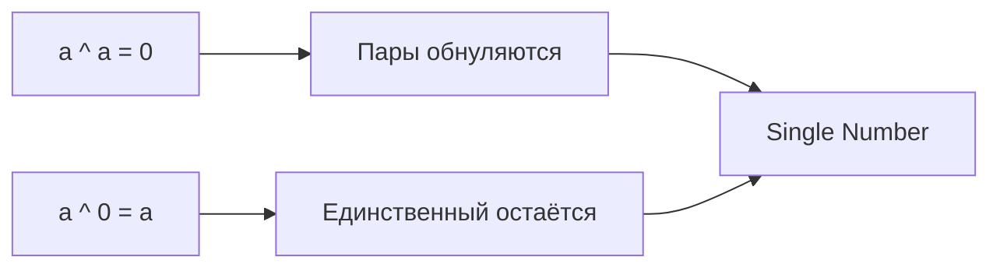

# Bit Manipulation (Битовые операции)

## Теория

**Bit Manipulation** использует побитовые операции (AND, OR, XOR, сдвиги) для
решения задач с минимальной памятью. Ключевое свойство — «самообнуление» XOR:
`a ^ a = 0` и `a ^ 0 = a`. Это позволяет находить единственный элемент среди пар,
работать с флагами и масками битов за **O(1)** дополнительной памяти.

**Когда применять:**

- нужно найти единственный элемент среди пар;
- проверить или изменить отдельные биты числа;
- работать с множеством флагов (включено/выключено);
- задача упоминает «биты», «чётность», «степень двойки», требует O(1) памяти.

## Алгоритм

Целое число хранится как последовательность битов; позиции нумеруются справа
налево с нуля. Например, `5 = 0101` — биты на позициях 0 и 2 установлены,
`8 = 1000` — один бит (степень двойки).

### Базовые операторы

| Оператор | Обозначение | Описание |
|----------|-------------|----------|
| AND | `&` | 1 только если оба бита 1 |
| OR | `\|` | 1 если хотя бы один бит 1 |
| XOR | `^` | 1 если биты разные |
| NOT | `^x` (унарный в Go) | Побитовое дополнение всех битов |
| Сдвиг влево | `<<` | Умножение на 2^n |
| Сдвиг вправо | `>>` | Целочисленное деление на 2^n |

### Свойства XOR

- `a ^ a = 0` — одинаковые значения обнуляются;
- `a ^ 0 = a` — нейтральный элемент;
- `a ^ b ^ a = b` — коммутативность и ассоциативность.

**Поиск единственного числа.** XOR всех элементов: пары обнуляются, остаётся
непарный элемент.

```go
// Single Number: один элемент встречается 1 раз, остальные — по 2 раза
func singleNumber(nums []int) int {
    result := 0
    for _, num := range nums {
        result ^= num // пары обнуляются, остаётся единственный
    }
    return result
}
```

**Проверка степени двойки.** У степени двойки ровно один установленный бит, а
`n & (n-1)` обнуляет младший единичный бит.

```go
func isPowerOfTwo(n int) bool {
    if n <= 0 {
        return false
    }
    return n&(n-1) == 0
}
```

**Подсчёт единичных битов (Brian Kernighan).** Каждая итерация удаляет младший
установленный бит, поэтому число итераций равно числу единиц.

```go
func hammingWeight(n uint32) int {
    count := 0
    for n != 0 {
        n &= n - 1 // удаляем младший установленный бит
        count++
    }
    return count
}
```

### Манипуляции с отдельными битами

| Операция | Код (Go) | Описание |
|----------|----------|----------|
| Проверить i-й бит | `(n >> i) & 1` | 1 если бит установлен |
| Установить i-й бит | `n \| (1 << i)` | Включить бит |
| Сбросить i-й бит | `n &^ (1 << i)` | Выключить бит (AND NOT) |
| Переключить i-й бит | `n ^ (1 << i)` | XOR с маской |
| Изолировать младший 1 | `n & (-n)` | Получить младший установленный бит |
| Сбросить младший 1 | `n & (n-1)` | Удалить младший бит |

### Сложность

| Операция | Время | Память |
|----------|-------|--------|
| Single Number (XOR) | O(n) | O(1) |
| Power of Two | O(1) | O(1) |
| Hamming Weight | O(k), k — число единичных битов | O(1) |
| Проверка/установка бита | O(1) | O(1) |

## Визуализация



XOR для Single Number `[4, 1, 2, 1, 2]`:

```
result = 0
result ^= 4  →  0 ^ 4 = 4   (0100)
result ^= 1  →  4 ^ 1 = 5   (0100 ^ 0001 = 0101)
result ^= 2  →  5 ^ 2 = 7   (0101 ^ 0010 = 0111)
result ^= 1  →  7 ^ 1 = 6   (0111 ^ 0001 = 0110)
result ^= 2  →  6 ^ 2 = 4   (0110 ^ 0010 = 0100)

Пары (1,1) и (2,2) обнулились. Осталось 4.
```

Проверка степени двойки через `n & (n-1)`:

```
n = 8:  1000      n = 6:  0110
n-1=7:  0111      n-1=5:  0101
8 & 7 = 0000 ✓    6 & 5 = 0100 ✗
```

## Типичные ошибки

1. **Путаница `^` и возведения в степень**: в Go `^` — это XOR, а не степень.
2. **Приоритет операций**: `n & n-1` требует скобок — пишите `n & (n-1)`.
3. **Сдвиг отрицательных**: сдвиг вправо знакового `int` арифметический (сохраняет
   знак); для битовых масок используйте `uint`/`uint32`.
4. **Отрицательные числа**: побитовые операции над `int` работают в дополнительном
   коде — для беззнаковой логики берите `uint`.
5. **Пустой массив в Single Number**: непарного элемента нет, XOR вернёт 0 — обработайте
   по соглашению.

## Задачи

**LeetCode:**

- [Single Number](https://leetcode.com/problems/single-number/) (136)
- [Single Number II](https://leetcode.com/problems/single-number-ii/) (137)
- [Single Number III](https://leetcode.com/problems/single-number-iii/) (260)
- [Number of 1 Bits](https://leetcode.com/problems/number-of-1-bits/) (191)
- [Power of Two](https://leetcode.com/problems/power-of-two/) (231)
- [Hamming Distance](https://leetcode.com/problems/hamming-distance/) (461)
- [Missing Number](https://leetcode.com/problems/missing-number/) (268) — XOR-решение
- [Reverse Bits](https://leetcode.com/problems/reverse-bits/) (190)

## Связанные шаблоны

- **[Modified Binary Search](modified-binary-search.md)** — бинарный поиск по
  позиции бита.
- **[Cyclic Sort](cyclic-sort.md)** — альтернатива для поиска отсутствующего числа
  (O(n), но модифицирует массив).
- Для общей теории по памяти и профилированию в Go см.
  [приложение](appendix-go-memory.md).
