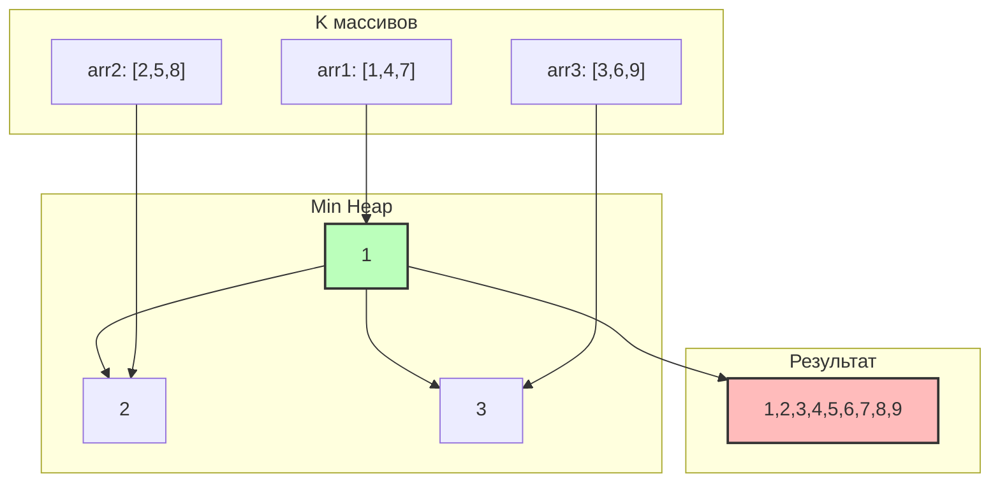

# K-way Merge (K-way слияние)

## Теория

**K-way Merge** объединяет K отсортированных массивов (списков, потоков) в один
отсортированный результат. Это обобщение слияния двух отсортированных массивов.

Ключевая идея: следующий минимальный элемент результата — это минимум среди *первых*
непрочитанных элементов всех K массивов. Min-heap позволяет находить этот минимум за
O(log k), храня по одному «текущему» элементу от каждого массива. Извлекли минимум —
добавили следующий элемент из того же массива.

**Когда применять:**

- нужно слить K отсортированных массивов/списков в один;
- требуется внешняя сортировка (данные не помещаются в память, лежат в отсортированных
  файлах);
- нужно обработать несколько отсортированных потоков и брать глобальный минимум.

## Алгоритм

Кладём в кучу первый элемент каждого массива вместе с индексом массива и позицией.
Пока куча не пуста: извлекаем минимум в результат и добавляем следующий элемент из
того же массива.

```go
import "container/heap"

// Элемент кучи: значение + откуда оно пришло
type Element struct {
    Val      int // значение
    ArrayIdx int // индекс массива
    ElemIdx  int // позиция в этом массиве
}

type MinHeap []Element

func (h MinHeap) Len() int            { return len(h) }
func (h MinHeap) Less(i, j int) bool  { return h[i].Val < h[j].Val }
func (h MinHeap) Swap(i, j int)       { h[i], h[j] = h[j], h[i] }
func (h *MinHeap) Push(x interface{}) { *h = append(*h, x.(Element)) }
func (h *MinHeap) Pop() interface{} {
    old := *h
    n := len(old)
    x := old[n-1]
    *h = old[:n-1]
    return x
}

func mergeKSortedArrays(arrays [][]int) []int {
    h := &MinHeap{}
    heap.Init(h)
    // Первый элемент каждого непустого массива
    for i := range arrays {
        if len(arrays[i]) > 0 {
            heap.Push(h, Element{Val: arrays[i][0], ArrayIdx: i, ElemIdx: 0})
        }
    }

    result := make([]int, 0)
    for h.Len() > 0 {
        minElem := heap.Pop(h).(Element) // глобальный минимум среди непрочитанных
        result = append(result, minElem.Val)

        next := minElem.ElemIdx + 1
        if next < len(arrays[minElem.ArrayIdx]) {
            heap.Push(h, Element{
                Val:      arrays[minElem.ArrayIdx][next],
                ArrayIdx: minElem.ArrayIdx,
                ElemIdx:  next,
            })
        }
    }
    return result
}
```

### Сложность

| Подход                     | Время       | Память |
|----------------------------|-------------|--------|
| Наивный (минимум из k каждый раз) | O(n·k) | O(1)   |
| K-way merge с кучей        | O(n log k)  | O(k)   |

Где `n` — общее число элементов, `k` — количество массивов. Каждый из `n` элементов
проходит через push/pop кучи размера ≤ k за O(log k).

## Визуализация

> 💡 **Интерактивная демонстрация.** Нажимайте «▶»: синим подсвечены текущие «головы»
> списков, жёлтым — выбранный минимум, который уходит в результат. (Виджет работает в
> собранной книге `mdbook serve`/`mdbook build`, а не при просмотре `.md` на GitHub.)

<div class="algo-viz" data-viz="kway-merge" data-lists="1,4,7;2,5,8;3,6,9"></div>

Слияние трёх массивов `[1,4,7]`, `[2,5,8]`, `[3,6,9]`.



В куче всегда лежит «голова» каждого массива. Извлекаем минимум, подкладываем
следующий элемент того же массива:

```
Init:    куча {1,2,3}                          результат []
поп 1 (arr1) → push 4   куча {2,3,4}           результат [1]
поп 2 (arr2) → push 5   куча {3,4,5}           результат [1,2]
поп 3 (arr3) → push 6   куча {4,5,6}           результат [1,2,3]
поп 4 (arr1) → push 7   куча {5,6,7}           результат [1,2,3,4]
...
поп 9 (arr3) → arr3 пуст куча {}               результат [1,2,3,4,5,6,7,8,9]
```

## Типичные ошибки

1. **Не сохранён источник элемента** — в куче нужно хранить индекс массива и позицию,
   иначе непонятно, какой элемент подкладывать следующим.
2. **Добавление пустых массивов на старте** — кладите в кучу только первый элемент
   *непустых* массивов.
3. **Выход за границу при подкладывании** — проверяйте `next < len(arrays[idx])`
   перед push.
4. **Сравнение в `Less` наоборот** — для min-heap это `h[i].Val < h[j].Val`; знак `>`
   даст max-heap и неверный порядок.
5. **Забыли `heap.Init`** — куча, собранная без Init/Push, не поддерживает инвариант.

## Задачи

**LeetCode:**

- [Merge k Sorted Lists](https://leetcode.com/problems/merge-k-sorted-lists/)
- [Kth Smallest Element in a Sorted Matrix](https://leetcode.com/problems/kth-smallest-element-in-a-sorted-matrix/)
- [Find K Pairs with Smallest Sums](https://leetcode.com/problems/find-k-pairs-with-smallest-sums/) (сложная)
- [Smallest Range Covering Elements from K Lists](https://leetcode.com/problems/smallest-range-covering-elements-from-k-lists/) (сложная)

**Тренажёр** — пакет `kwaymerge`:

```bash
cd exercises
go test ./kwaymerge/                 # ваши решения
go test -tags solution ./kwaymerge/  # эталон
```

Реализуйте `MergeKSortedArrays` (слить k массивов), `KthSmallestInSortedArrays`
(k-й наименьший), `SmallestRange` (наименьший диапазон, покрывающий все списки) и
`KthSmallestInMatrix` (k-й наименьший в сортированной матрице).

## Связанные шаблоны

- **[Top K Elements](top-k-elements.md)** — тоже опирается на кучу для выбора
  экстремальных элементов.
- **[Two Heaps](two-heaps.md)** — другой шаблон на основе куч.
- **[Modified Binary Search](modified-binary-search.md)** — альтернатива для
  отсортированных данных.
- Для общей теории по памяти и профилированию в Go см.
  [приложение](appendix-go-memory.md).
