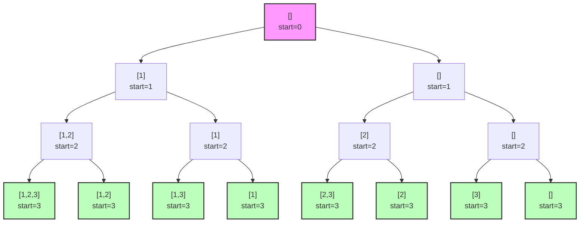

# Subsets (Подмножества)

## Теория

Шаблон **Subsets** генерирует все возможные подмножества множества. Для каждого
элемента есть два выбора — **включить** его в подмножество или **не включать**. Это
образует бинарное дерево решений с 2^n листьями, по одному на каждое подмножество.

Основной приём — **backtracking** (откат): строим решение пошагово в одном общем
массиве, после обработки варианта «откатываемся» — убираем добавленный элемент. Это
экономит память, не создавая 2^n промежуточных копий.

**Когда применять:**

- нужно сгенерировать все подмножества или комбинации;
- задача — перебор всех вариантов по принципу «включить/исключить»;
- нужны подмножества с определёнными свойствами (комбинации, перестановки, сумма).

## Алгоритм

На каждом шаге добавляем элемент в `current`, рекурсивно обрабатываем остаток, затем
откатываемся. Текущее подмножество сохраняем в результат **копией**, так как `current`
будет меняться дальше.

```go
func subsets(nums []int) [][]int {
    var result [][]int
    var current []int

    var backtrack func(start int)
    backtrack = func(start int) {
        // Сохраняем копию текущего подмножества
        subset := make([]int, len(current))
        copy(subset, current)
        result = append(result, subset)

        for i := start; i < len(nums); i++ {
            current = append(current, nums[i]) // выбор: включить nums[i]
            backtrack(i + 1)
            current = current[:len(current)-1] // откат: убрать nums[i]
        }
    }

    backtrack(0)
    return result
}
```

Для подмножеств с дубликатами сортируем массив и пропускаем повторы на одном уровне:

```go
func subsetsWithDup(nums []int) [][]int {
    sort.Ints(nums)
    var result [][]int
    var current []int

    var backtrack func(start int)
    backtrack = func(start int) {
        subset := make([]int, len(current))
        copy(subset, current)
        result = append(result, subset)

        for i := start; i < len(nums); i++ {
            if i > start && nums[i] == nums[i-1] {
                continue // пропускаем дубликат на этом уровне
            }
            current = append(current, nums[i])
            backtrack(i + 1)
            current = current[:len(current)-1]
        }
    }

    backtrack(0)
    return result
}
```

Альтернатива — **итеративный** подход: начать с `[[]]` и для каждого элемента добавить
его ко всем существующим подмножествам.

### Сложность

| Подход                    | Время       | Память                  |
|---------------------------|-------------|-------------------------|
| Рекурсивный (backtracking) | O(2^n · n) | O(2^n · n), стек O(n)   |
| Итеративный               | O(2^n · n)  | O(2^n · n)              |

Всего 2^n подмножеств, и каждое копируется за O(n). Backtracking не меняет время, но
переиспользует один массив вместо хранения всех путей.

## Визуализация

Дерево решений для `[1, 2, 3]` (зелёные узлы — сохранённые подмножества):



Результат: `[[], [1], [1,2], [1,2,3], [1,3], [2], [2,3], [3]]`.

## Типичные ошибки

1. **Забыт откат** — после рекурсивного вызова обязательно `current = current[:len(current)-1]`.
2. **Сохранение без копии** — `result = append(result, current)` сохраняет ссылку на изменяемый слайс; копируйте через `copy`.
3. **Дубликаты не обработаны** — для массива с повторами сортируйте и пропускайте `nums[i] == nums[i-1]` при `i > start`.
4. **Пустой массив** — корректно вернуть `[][]int{{}}` (единственное пустое подмножество).
5. **Очень большое n** — 2^n растёт экспоненциально; следите за памятью, для глубокой рекурсии предпочтите итеративный подход.

## Задачи

**LeetCode:**

- [Subsets](https://leetcode.com/problems/subsets/)
- [Subsets II](https://leetcode.com/problems/subsets-ii/)
- [Combinations](https://leetcode.com/problems/combinations/)
- [Combination Sum](https://leetcode.com/problems/combination-sum/)
- [Permutations](https://leetcode.com/problems/permutations/)
- [Letter Combinations of a Phone Number](https://leetcode.com/problems/letter-combinations-of-a-phone-number/)
- [Generate Parentheses](https://leetcode.com/problems/generate-parentheses/)
- [N-Queens](https://leetcode.com/problems/n-queens/) (сложная)

## Связанные шаблоны

- **[Tree DFS](./tree-dfs.md)** — тот же рекурсивный обход в глубину.
- **[Topological Sort](./topological-sort.md)** — работа с графами и зависимостями.
- **[Modified Binary Search](./modified-binary-search.md)** — поиск в отсортированных данных.
- Для общей теории по памяти и профилированию в Go см. [приложение](appendix-go-memory.md).
