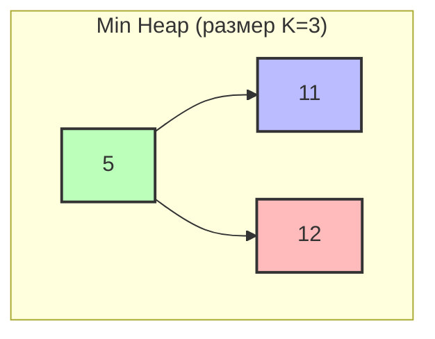

# Top K Elements (Топ K элементов)

## Теория

**Top K Elements** — шаблон для поиска K наибольших, наименьших или наиболее частых
элементов коллекции без полной сортировки. Ключевая идея — поддерживать **кучу
размера K** (приоритетную очередь): нам не нужны все элементы в порядке, достаточно
держать инвариант «в куче — K лучших».

**Куча (heap)** даёт минимум/максимум за O(1), а вставку и удаление за O(log K).
См. [Глоссарий](./glossary.md).

**Когда применять:**

- нужно найти K наибольших/наименьших элементов;
- нужно найти K наиболее частых элементов;
- задача связана с приоритетами или ранжированием;
- решение без полной сортировки выгодно при `k << n`.

## Алгоритм

Для **K наибольших** держим **min-heap** размера K: вершина — это худший (минимальный)
из K лучших. Новый элемент больше вершины → выталкиваем вершину и вставляем новый.
Для **K наименьших** симметрично используем **max-heap**.

```go
import "container/heap"

// MinHeap — для K наибольших элементов
type MinHeap []int

func (h MinHeap) Len() int            { return len(h) }
func (h MinHeap) Less(i, j int) bool  { return h[i] < h[j] }
func (h MinHeap) Swap(i, j int)       { h[i], h[j] = h[j], h[i] }
func (h *MinHeap) Push(x interface{}) { *h = append(*h, x.(int)) }
func (h *MinHeap) Pop() interface{} {
    old := *h
    n := len(old)
    x := old[n-1]
    *h = old[:n-1]
    return x
}

// K наибольших элементов
func findKLargest(nums []int, k int) []int {
    if k <= 0 || len(nums) == 0 {
        return nil
    }
    h := &MinHeap{}
    heap.Init(h)
    for _, num := range nums {
        if h.Len() < k {
            heap.Push(h, num)
        } else if num > (*h)[0] { // больше худшего из лучших — заменяем
            heap.Pop(h)
            heap.Push(h, num)
        }
    }
    result := make([]int, h.Len())
    for i := len(result) - 1; i >= 0; i-- {
        result[i] = heap.Pop(h).(int)
    }
    return result
}
```

Для **K наиболее частых** сначала считаем частоты в `map`, затем тем же приёмом
отбираем K элементов с наибольшей частотой:

```go
func topKFrequent(nums []int, k int) []int {
    freq := make(map[int]int, len(nums))
    for _, num := range nums {
        freq[num]++
    }
    type pair struct{ num, count int }
    pairs := make([]pair, 0, len(freq))
    for num, count := range freq {
        pairs = append(pairs, pair{num, count})
    }
    sort.Slice(pairs, func(i, j int) bool { return pairs[i].count > pairs[j].count })
    result := make([]int, k)
    for i := 0; i < k; i++ {
        result[i] = pairs[i].num
    }
    return result
}
```

### Сложность

| Задача                | Время       | Память |
|-----------------------|-------------|--------|
| K наибольших/наименьших | O(n log k) | O(k)   |
| K наиболее частых     | O(n + k log k) | O(n)  |

Куча размера K даёт O(n log k) против O(n log n) полной сортировки — заметный выигрыш
при малом k.

## Визуализация

> 💡 **Интерактивная демонстрация (построение min-кучи).** Нажимайте «▶»: элементы
> вставляются по одному и «всплывают» вверх (sift-up), пока на вершине не окажется
> минимум. (Виджет работает в собранной книге `mdbook serve`/`mdbook build`, а не при
> просмотре `.md` на GitHub.)

<div class="algo-viz" data-viz="heap-insert" data-array="5,3,8,1,9,2"></div>

Поиск топ-3 наибольших в `[3, 1, 5, 12, 2, 11]`, K = 3, с min-heap:



Пошагово:

```
3:  []        → [3]
1:  [3]       → [1, 3]
5:  [1, 3]    → [1, 3, 5]      куча заполнена (размер = K)
12: [1,3,5]   min=1, 12>1 → удалить 1, вставить 12 → [3, 5, 12]
2:  [3,5,12]  min=3, 2<3 → пропустить               → [3, 5, 12]
11: [3,5,12]  min=3, 11>3 → удалить 3, вставить 11 → [5, 11, 12]
```

Результат — топ-3: **[5, 11, 12]**.

## Типичные ошибки

1. **Неправильный тип кучи** — для K наибольших нужен min-heap, для K наименьших — max-heap.
2. **Сравнение не с вершиной** — новый элемент сравнивайте именно с корнем кучи `(*h)[0]`.
3. **Куча не ограничена по размеру** — забыв вытолкнуть лишнее, получаете O(n log n) и O(n) памяти.
4. **Пустой массив или `k = 0`** — возвращайте пустой результат до работы с кучей.
5. **`k >= len(nums)`** — тогда возвращаются все элементы, отдельная обработка не нужна, но проверьте границы.
6. **Большое k** (`k > n/2`) — куча перестаёт быть выгодной, рассмотрите QuickSelect или сортировку.

## Задачи

**LeetCode:**

- [Kth Largest Element in an Array](https://leetcode.com/problems/kth-largest-element-in-an-array/)
- [Top K Frequent Elements](https://leetcode.com/problems/top-k-frequent-elements/)
- [K Closest Points to Origin](https://leetcode.com/problems/k-closest-points-to-origin/)
- [Sort Characters By Frequency](https://leetcode.com/problems/sort-characters-by-frequency/)
- [Merge k Sorted Lists](https://leetcode.com/problems/merge-k-sorted-lists/) (сложная)
- [Find K Pairs with Smallest Sums](https://leetcode.com/problems/find-k-pairs-with-smallest-sums/) (сложная)

**Тренажёр** — пакет `topk`:

```bash
cd exercises
go test ./topk/                 # ваши решения
go test -tags solution ./topk/  # эталон
```

Реализуйте `FindKLargest` (k наибольших), `TopKFrequent` (k самых частых),
`KthLargest` (k-й по величине), `KClosestPoints` (k ближайших точек к началу координат)
и `KClosestNumbers` (k ближайших к x).

## Связанные шаблоны

- **[Two Heaps](./two-heaps.md)** — две кучи для поддержания медианы.
- **[K-way Merge](./k-way-merge.md)** — куча для слияния отсортированных массивов.
- **[Sliding Window](./sliding-window.md)** — комбинируется с кучей для максимума/минимума в окне.
- Для общей теории по памяти и профилированию в Go см. [приложение](appendix-go-memory.md).
