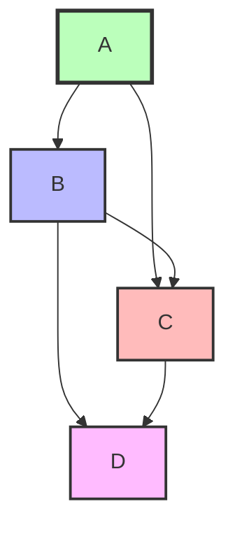

# Topological Sort (Топологическая сортировка)

## Теория

**Topological Sort** находит линейный порядок вершин ориентированного ациклического
графа (**DAG**), где каждое ребро — зависимость: если A → B, то A идёт перед B.

**DAG** — ориентированный граф без циклов. Топологическая сортировка существует тогда
и только тогда, когда граф — DAG; при наличии цикла порядок построить нельзя.

Ключевое наблюдение: в DAG всегда есть вершина без входящих рёбер (**in-degree = 0**) —
источник. Обрабатывая источники и «удаляя» их из графа, мы открываем новые источники
и строим порядок. Это и есть **алгоритм Кана** (BFS по in-degree).

**Когда применять:**

- работа с DAG, зависимостями между задачами;
- нужно определить порядок выполнения (сборка, установка пакетов, расписание);
- нужно проверить отсутствие циклов (можно ли выполнить все задачи).

## Алгоритм

Считаем in-degree каждой вершины, кладём в очередь все вершины с in-degree = 0. Берём
вершину из очереди, добавляем в результат, уменьшаем in-degree её соседей; когда
in-degree соседа становится 0 — кладём его в очередь. Если в результате оказалось
меньше вершин, чем всего, — в графе есть цикл.

```go
// Алгоритм Кана. prerequisites[i] = {course, prerequisite}: course зависит от prerequisite
func topologicalSort(numCourses int, prerequisites [][]int) []int {
    graph := make([][]int, numCourses)
    inDegree := make([]int, numCourses)

    for _, prereq := range prerequisites {
        course, prerequisite := prereq[0], prereq[1]
        graph[prerequisite] = append(graph[prerequisite], course)
        inDegree[course]++
    }

    queue := []int{}
    for i := 0; i < numCourses; i++ {
        if inDegree[i] == 0 {
            queue = append(queue, i)
        }
    }

    result := []int{}
    for len(queue) > 0 {
        node := queue[0]
        queue = queue[1:]
        result = append(result, node)

        for _, neighbor := range graph[node] {
            inDegree[neighbor]--
            if inDegree[neighbor] == 0 {
                queue = append(queue, neighbor)
            }
        }
    }

    if len(result) != numCourses {
        return []int{} // обнаружен цикл — сортировка невозможна
    }
    return result
}
```

**Альтернатива — DFS-подход:** обходим граф в глубину, и когда вершина полностью
обработана (все потомки посещены), кладём её в стек. Развёрнутый стек даёт топологический
порядок; цикл ловится по «серой» (находящейся в обработке) вершине.

### Сложность

| Подход         | Время    | Память   |
|----------------|----------|----------|
| Алгоритм Кана (BFS) | O(V + E) | O(V + E) |
| DFS            | O(V + E) | O(V + E) |

Каждая вершина обрабатывается один раз (O(V)), каждое ребро рассматривается один раз
(O(E)).

## Визуализация

Граф зависимостей: A → B, A → C, B → C, B → D, C → D.



Процесс алгоритма Кана:

```
In-degree:  A:0  B:1  C:2  D:2
очередь [A]         result []
A → result [A]      B:1→0 (в очередь), C:2→1     очередь [B]
B → result [A,B]    C:1→0 (в очередь), D:2→1     очередь [C]
C → result [A,B,C]  D:1→0 (в очередь)            очередь [D]
D → result [A,B,C,D]                             очередь []
```

Топологический порядок: **[A, B, C, D]**.

Граф с циклом `A → B → C → A` даёт in-degree A=1, B=1, C=1 — ни одной вершины с
in-degree = 0, очередь пуста с самого начала, `len(result) < V` → цикл.

## Типичные ошибки

1. **Путаница in-degree/out-degree** — считайте входящие рёбра, а не исходящие.
2. **Неправильное направление ребра** — `course` зависит от `prerequisite`, поэтому ребро `prerequisite → course`.
3. **Забыта проверка цикла** — если `len(result) != numCourses`, сортировка невозможна.
4. **In-degree обновляется не у тех вершин** — уменьшайте только у прямых соседей текущей вершины.
5. **Несколько источников / компонент связности** — кладите в очередь сразу все вершины с in-degree = 0, иначе пропустите часть графа.
6. **Дубликаты рёбер** в `prerequisites` завышают in-degree; при необходимости отсеивайте через множество.

## Задачи

**LeetCode:**

- [Course Schedule](https://leetcode.com/problems/course-schedule/)
- [Course Schedule II](https://leetcode.com/problems/course-schedule-ii/)
- [Alien Dictionary](https://leetcode.com/problems/alien-dictionary/)
- [Minimum Height Trees](https://leetcode.com/problems/minimum-height-trees/)
- [Sequence Reconstruction](https://leetcode.com/problems/sequence-reconstruction/)
- [Parallel Courses](https://leetcode.com/problems/parallel-courses/) (сложная)
- [Sort Items by Groups Respecting Dependencies](https://leetcode.com/problems/sort-items-by-groups-respecting-dependencies/) (сложная)

## Связанные шаблоны

- **[Tree BFS](./tree-bfs.md)** — тот же обход с очередью.
- **[Tree DFS](./tree-dfs.md)** — альтернативный подход через DFS.
- **[Subsets](./subsets.md)** — комбинаторные задачи с зависимостями.
- Для общей теории по памяти и профилированию в Go см. [приложение](appendix-go-memory.md).
